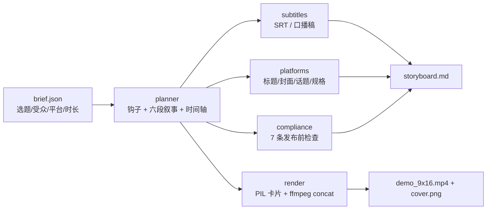

# 架构与设计取舍

## 目标 / 非目标

**目标**

- 把一条选题变成可直接执行的分镜包：时间轴、画面任务、口播、字幕、平台版本、合规结论；
- 所有环节离线可跑，不依赖云端生成服务；
- 能渲染一条带字幕的样片，用于内部过片与节奏校验。

**非目标**

- 不生成最终画面/数字人，不替代剪辑与拍摄；
- 不承诺播放量，不做投放优化；
- 不做版权素材库与音乐授权管理。

## 数据流

## 六段叙事

| 段落 | 权重 | 任务 |
| --- | --- | --- |
| `hook` | 0.08 | 3 秒内给出反常识/指令型开头，留住人 |
| `problem` | 0.15 | 用具体场景让观众认领问题 |
| `criteria` | 0.29 | 给判断标准，信息图逐条弹出 |
| `action` | 0.27 | 给可执行清单，手部演示/清单卡片 |
| `caveat` | 0.13 | 边界与免责，降低误读风险 |
| `cta` | 0.08 | 收藏/转发/关注，重复一次动作指令 |

## 时间轴算法

1. 每句口播按 **4.5 字/秒** 估算自然时长，单镜下限 1.6 秒；
2. 总时长不足目标：余量按段落权重分成 B-roll 素材位（≥3 秒才建位）；
3. 总时长超出目标：整体等比压缩到目标时长，并在 `pacing.note` 里给出“需删减多少字 / 建议时长”；
4. 浮点误差吸收到最后一镜，保证总时长严格等于目标。

这里刻意**不偷偷加速语速**：压缩只发生在时间轴上，同时把“语速偏快”的警告显式写进分镜包，让人来决定删字还是放长。

## 渲染层

- `render.py` 用 Pillow 逐镜画 720×1280 卡片：段落标签、镜号、字幕、进度条；
- 中文字体按 Noto Sans CJK → AR PL UMing 回退，找不到字体直接报错而不是画方块；
- 字幕按**像素宽度**折行并自动缩字号，避免长句横向溢出；
- ffmpeg concat 成片，样片只用于节奏校验，不是终版。

## 失败模式与处理

| 失败 | 表现 | 当前处理 |
| --- | --- | --- |
| 口播超出时长 | 语速 >5.8 字/秒 | `pacing.note` 明确提示删减字数或放宽时长；不静默加速 |
| 钩子过长 | 3 秒念不完 | 钩子候选限制 ≤30 字，并有单测 |
| 封面文案截断 | “熬夜后心慌，什么时候必…” | 取首个逗号前短语，按像素宽度折行 |
| 字幕溢出 | 长句横向出画 | 像素宽度折行 + 自动缩字号 |
| 缺 ffmpeg / 字体 | 渲染失败 | 明确报错；无 ffmpeg 时仍可输出全部文本产物 |

## 扩展点

- **新平台**：在 `platforms.py` 加规格（画幅、时长上限、标题/封面/话题规则）；
- **新题材模板**：在 `planner.BEAT_SPECS` 增加段落或调整权重，但保持总权重为 1；
- **新合规规则**：在 `compliance.py` 加 `Cxxx`，返回级别、证据与建议；
- **真实素材替换**：`plan.json` 的每镜都有 `visual` 与时间窗，可直接映射到拍摄清单或生成模型。
